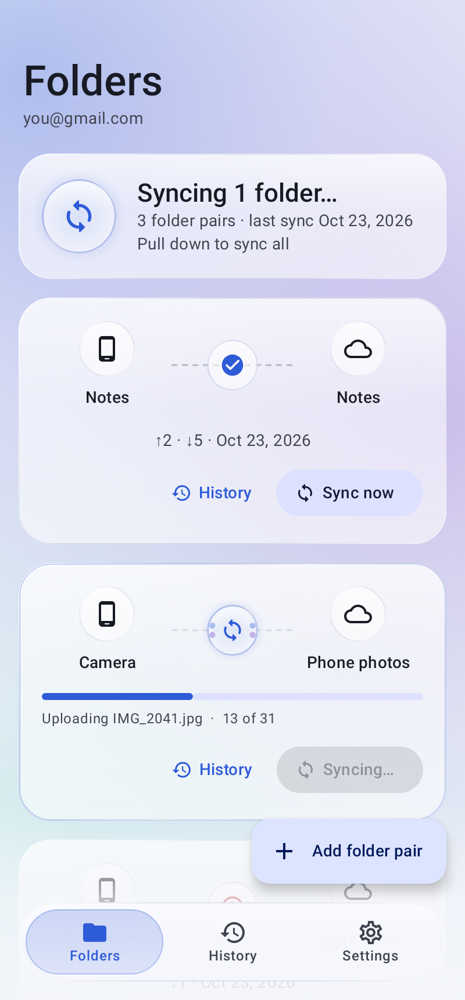
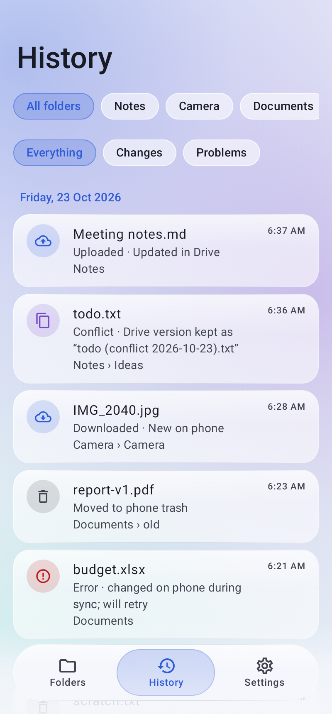
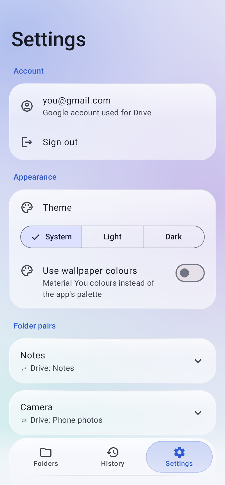
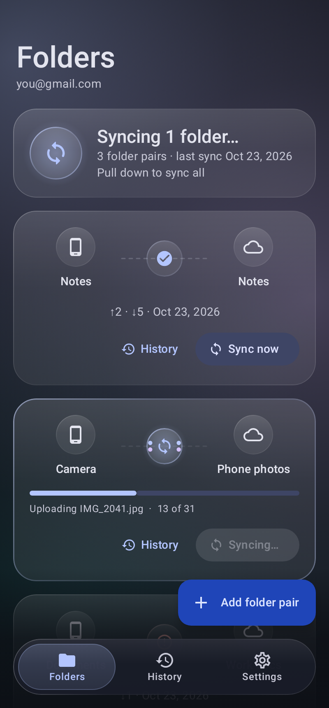
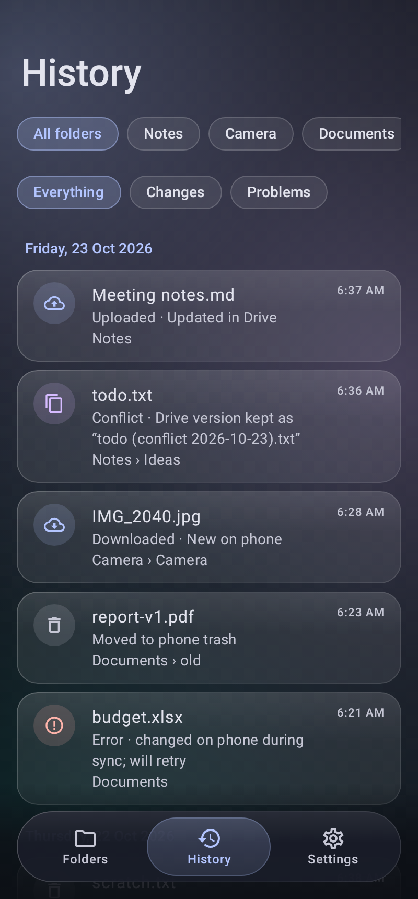
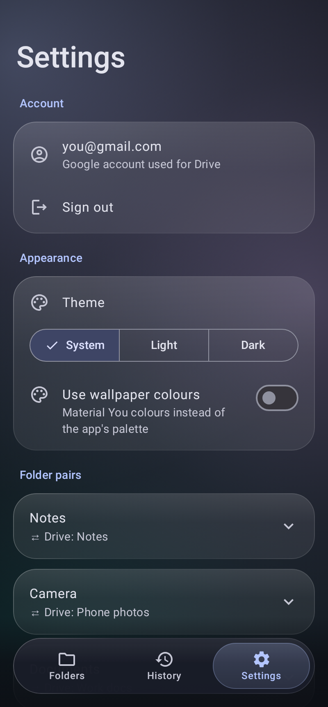

# Drive Folder Sync

A personal Android app that two-way syncs phone folders with Google Drive folders.
It's built with Kotlin and Jetpack Compose. **Setup: see [SETUP.md](SETUP.md)** (doable entirely from a phone).

## Screens

| Folders | History | Settings |
|---|---|---|
|  |  |  |
|  |  |  |

Material 3 with a "liquid glass" layer: translucent frosted cards over a slowly drifting colour field, and a floating glass navigation bar whose selection slides on a spring. While a pair syncs, its orb spins, data dots stream both ways and a progress bar fills. Light, dark or system theme, plus optional wallpaper colours, are set in **Settings**. All motion stops when Android's *Remove animations* is on.

Regenerate the screenshots with `./gradlew testDebugUnitTest -Pscreenshots` (Robolectric + Roborazzi, no device needed).

## Tests

`./gradlew testDebugUnitTest` runs the planner, exclude-rule and conflict-name unit tests plus `SyncScenarioTest`: 35 end-to-end scenarios that drive the real `SyncEngine` and Room (in memory, under Robolectric) against fake phone and Drive sides, several sync runs each, checking both sides and the baseline. CI runs them before every build, and a failing test stops the release, so the app never auto-updates to it.

## How it syncs

Each *pair* links one phone folder (picked with the Storage Access Framework) to one Drive folder, subfolders included.
It syncs every 15 minutes through WorkManager, and on demand with **Sync now**. *Wi-Fi only* and *charging only* can be set per pair.

Every run does a three-way compare of **phone ↔ baseline ↔ Drive**. The baseline is what both sides looked like after the last successful sync.

| Phone | Drive | Result |
|---|---|---|
| changed | unchanged | upload (resumable, MD5-verified) |
| unchanged | changed | download (MD5-verified, written via a temp file) |
| changed | changed | if the bytes match, nothing to do; otherwise **keep both** (below) |
| deleted | unchanged | Drive file → **Drive trash** (never permanent) |
| unchanged | deleted | phone file → **`.sync-trash/`** in the pair's folder, purged after 30 days |
| deleted | changed | edit wins: download again |
| changed | deleted | edit wins: upload again |

### Data-safety rules

- **Conflicts keep both copies.** The Drive version is renamed `name (conflict YYYY-MM-DD).ext` on both sides. The phone version keeps the original name.
- **The first sync of a pair only merges.** Nothing is deleted on either side until one sync has finished with no errors.
- **Mass-delete guard.** If either side suddenly looks empty but the pair had at least 5 synced files, the sync stops and makes no changes.
- **Edits beat deletes.**
- **A download that fails halfway** (phone storage full, say) is retried next run. The half-written file is never mistaken for a phone edit.
- **Unsyncable items are skipped, not deleted.** This covers Google Docs/Sheets/Slides (no binary content), duplicate names in one Drive folder, and names that differ only by case.

### Also

- **History:** each pair keeps a log of uploads, downloads, conflicts, trashed files and errors. Open it from the **History** tab, the **History** button on a pair, or a conflict notification.
- **Notifications:** you're notified when a conflict copy is created, and when syncing pauses because Google access expired.
- **Exclude rules:** gitignore-style patterns per pair (**Settings → Folder pairs → Exclude files**), such as `*.tmp`, `node_modules/` or `Photos/raw`. Excluded paths are ignored on both sides and never deleted.
- **Auto-update:** the app checks GitHub Releases twice a day and installs newer builds signed with the same key.

### Drive side

Drive changes are read from the **Changes API** with a saved `startPageToken`. The token only advances after a run with zero failures, so a failed file is retried next time.
A full listing runs on the first sync, when the token is rejected, and once every 24 hours as a safety net.
Drive is ID/parent based, so the engine rebuilds paths from the parent chain (`RemoteTree`). A renamed or moved folder therefore moves its contents too.

## Code map

| Path | What |
|---|---|
| `sync/Planner.kt` | Pure three-way decision table (unit-tested) |
| `sync/SyncEngine.kt` | Builds snapshots, runs the plan, updates the baseline per file |
| `sync/RemoteTree.kt` | Drive id/parent → path resolution, duplicate handling |
| `drive/DriveClient.kt` | `DriveApi` interface + Drive v3 REST over OkHttp: changes, listing, resumable upload |
| `local/LocalFs.kt` | `LocalFs` interface + `SafLocalFs` (SAF access via `DocumentsContract`) |
| `auth/GoogleAuth.kt` | Credential Manager sign-in + `AuthorizationClient` (`drive` scope) |
| `sync/SyncWorker.kt`, `SyncScheduler.kt` | WorkManager jobs |
| `sync/ExcludeRules.kt` | Per-pair ignore patterns (unit-tested) |
| `update/` | Self-update from GitHub Releases, with a signature check |
| `Notifier.kt` | Conflict, sign-in, update and progress notifications |
| `ui/glass/` | Theme, glass surfaces, ambient background, floating nav bar |
| `ui/` | Folders / History / Settings screens, sync animation (`SyncFlow.kt`) |
| `docs/` | GitHub Pages home page + privacy policy for the OAuth consent screen |
| `test/…/sync/SyncScenarioTest.kt` | End-to-end sync runs against in-memory phone and Drive fakes (`sync/fakes/`) |
| `.github/workflows/release.yml` | Tests, then signed APK → GitHub Release on every push; prints signing SHA-1 |
| `.github/workflows/keystore.yml` | One-time signing key generator |

## Known limits

- Shared drives aren't supported (My Drive only).
- A resumable upload resumes within one sync run. If the job is killed mid-file, that file starts over next run.
- Changing a pair's exclude rules makes its next sync a full Drive scan, so files that were excluded are found on both sides instead of uploaded twice.
- The "N skipped" note for duplicate names in Drive shows after a full scan and clears on the next quick (Changes) run, though the duplicates are still skipped. It returns with the daily full scan.
- When a phone file and a Drive file differ only by case (`Notes.txt` vs `notes.txt`), both stay in Drive and the phone keeps its own; the Drive one is reported as skipped.
- Remote renames show up as delete + new. The old local copy goes to `.sync-trash`, and the file downloads under its new name.
